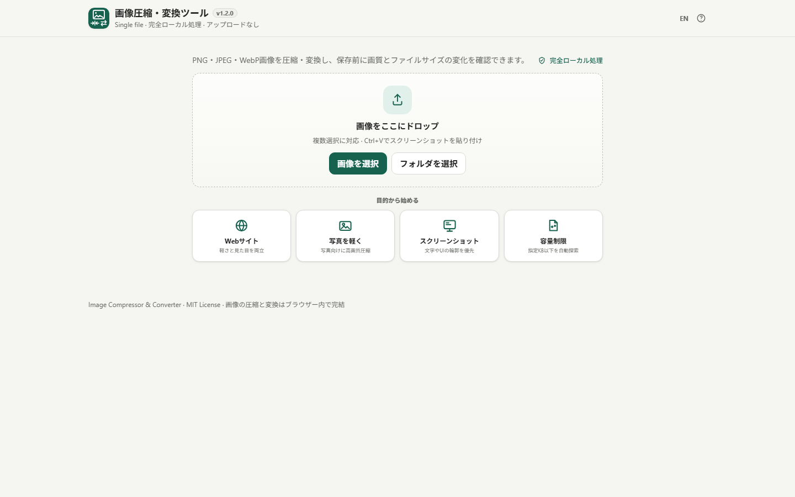

# 画像圧縮・変換ツール / Image Compressor & Converter

[](https://github.com/ttomohisa/htmlapps-image-compressor-converter/actions/workflows/deploy-pages.yml)
[](LICENSE)
[](https://ttomohisa.github.io/htmlapps-image-compressor-converter/)

[English README](README.md)

PNG / JPEG / WebPを対象に、**用途を選ぶだけで形式・品質・解像度を比較し、最適な出力を探す単一HTMLの画像最適化ワークベンチ**です。画像を外部へアップロードせず、Smart Optimizeも端末内だけで動作します。

[最新版の単体HTMLをダウンロード](https://github.com/ttomohisa/htmlapps-image-compressor-converter/releases/latest/download/index.html) · [リリースノートとその他のダウンロード](https://github.com/ttomohisa/htmlapps-image-compressor-converter/releases)

## 🚀 デモ

### [GitHub Pagesで画像圧縮・変換ツールを開く](https://ttomohisa.github.io/htmlapps-image-compressor-converter/)

GitHub Pagesから最初のHTMLを読み込んだ後、画像の読み込み・リサイズ・圧縮・形式変換・比較・Base64生成・保存は端末内で処理されます。選択した画像がアプリからサーバーへアップロードされることはありません。

### Start画面

[](https://ttomohisa.github.io/htmlapps-image-compressor-converter/)

### Workbench

[](https://ttomohisa.github.io/htmlapps-image-compressor-converter/)

スマートフォンでは画面下部から設定を開いたり、変換を開始したりできます。変換後は **結果を見る** でプレビューに移動できます。ビルド情報はヘルプの末尾にあります。


## 主な機能

- ファイルまたはフォルダから画像を追加。PCでは画像一覧、比較プレビュー、設定を並べて表示
- **Smart Optimize** で圧縮候補を端末内で比較。形式の自動選択では、半透明のピクセルが1つでもあれば透過に対応する形式を使用
- **目標容量** で品質と解像度を段階的に調整し、指定したKB数に近づける
- Webサイト / 写真 / スクリーンショット / 容量制限 / README / 透過画像 / 形式変換の目的ベースプリセット
- 変換後の方が大きい場合は元画像を自動維持（形式変換を優先したい場合は無効化可能）
- PCでは **Ctrl+V** でスクリーンショットやコピー画像を直接追加。ファイル選択はPC・スマホとも複数選択に対応
- 一括変換の進捗と成功・失敗件数を表示。結果を保存できる画像について、元容量・出力容量・合計削減率を集計
- Before / After、差分強調、100〜400%の拡大プレビュー
- 保存名を変更し、フォルダ構造を維持してZIP保存。**チェック済みをZIP保存** では対象枚数を確認でき、同名の出力にはZIP内で連番を付けて区別
- 選択した画像だけを確認後に削除し、ほかの画像と変換結果を維持
- **書き出し**画面にBase64 / HTML / CSS / Markdown / `<picture>` / Web素材ZIPを集約
- 日本語 / 英語を同じ単一HTML内で切り替え
- HTML読込後は **完全ローカル処理**。CSPの `connect-src 'none'` でも実行時通信を禁止

## すぐに使う

### Webで使う

[デモを開く](https://ttomohisa.github.io/htmlapps-image-compressor-converter/)だけで利用できます。インストールやアカウント登録は不要です。

### オフラインで使う

1. 最新リリースから [index.html](https://github.com/ttomohisa/htmlapps-image-compressor-converter/releases/latest/download/index.html) を保存します。
2. 保存したHTMLをブラウザーで直接開きます。開く前にネットワークを切断しても使えます。
3. 画像を追加して変換し、結果を保存します。

ダウンロード容量を抑えたい場合は、[自己展開版HTML](https://github.com/ttomohisa/htmlapps-image-compressor-converter/releases/latest/download/index.self-extract.html) を利用できます。gzipの `DecompressionStream` に対応したブラウザーで同じアプリが開きます。両方のファイルを検証する手順は [オフライン検証](VERIFY_OFFLINE.md) にあります。

## 使い方

1. **画像を選択**でPNG・JPEG・WebP画像を追加します。
2. PCでは用途を選んで **Smart Optimize**、スマホでは画面下の **自動圧縮** を押します。
3. プレビューで画質と容量を確認して保存します。スマホでは **結果を見る** でプレビューを開けます。

### 形式や容量を指定する

- 容量に上限があるときは **目標容量** をオンにしてKB数を入力します。**見た目優先 / サイズ優先** を選び、変換後の容量を確認してください。
- 形式を指定するには **詳細設定** で形式を選び、**設定どおり変換** を押します。常に指定形式で保存するには **元より大きければ元画像を維持** をオフにします。

Smart Optimizeは指定した品質の上限を守り、画質の基準を満たす候補がなければ元画像に最も近い結果を選びます。WebPを出力できないブラウザーでは、透明な画像はPNG、それ以外はJPEGを使います。

### 複数の画像をZIPで保存する

保存したい画像にチェックを付けて **チェック済みをZIP保存** を押します。1枚だけでもZIPになります。**すべて / 解除** で、変換済みの画像をまとめて選べます。

ZIPには元のフォルダ構成が引き継がれます。同じ名前が重なったときは、ZIP内でファイル名に連番が付きます。

### 画質を見比べる

境界線を左右に動かすと、左に元画像、右に変換後の画像が見えます。細かい違いは **差分を強調** で確認できます。

**JPEG / PNG / WebPを比較** では、同じ設定で形式ごとの容量と画像サイズを比べられます。保存したい候補を選んでください。

### Web制作向け出力

画像変換だけでなく、Web制作ですぐ使える以下の形式も生成できます。

- Base64 Data URI
- `` 用HTML
- CSS `background-image`
- Markdown画像記法
- フォールバック付き `<picture>`
- Web素材ZIP。編集した保存名と出力寸法に合わせた画像と `snippet.html` をまとめます。透過画像にはPNG、不透明画像にはJPEGを用意し、ブラウザーが対応していればWebPも含めます。

## GitHub Pagesで公開する

このリポジトリには、単体HTMLをビルド・検証して `dist/` をGitHub Pagesへ自動公開するワークフローが含まれています。

1. リポジトリ名を `htmlapps-image-compressor-converter` としてGitHubへプッシュします。
2. **Settings → Pages → Build and deployment → Source** で **GitHub Actions** を選択します。
3. `main` ブランチへプッシュするか、Actions画面からPages公開ワークフローを手動実行します。
4. ビルド成功後、`https://ttomohisa.github.io/htmlapps-image-compressor-converter/` で公開されます。

GitHub Pagesがまだ有効化されていない場合は、ビルド自体を成功させたままデプロイだけをスキップし、ActionsのSummaryに設定方法を表示する構成です。

## GitHub Releasesで配布する

`main` へのプッシュで `app.config.json` の `version` がプッシュ前より上がると、リリース用ワークフローが起動します。リポジトリ検証の成功後、プッシュされたコミットに `vX.Y.Z` のタグを付け、`index.html` と `index.self-extract.html` を公開します。上記のダウンロードリンクは最新の公開リリースを指します。[メンテナー向け手順](CONTRIBUTING.md)

## 開発とビルド

```text
.
├─ src/index.template.html       # アプリ本体のソーステンプレート
├─ app.config.json               # アプリ名・バージョン・ビルド設定
├─ dependencies.json             # 内包依存の定義
├─ build-standalone.bat          # Windows用ビルド入口
├─ build-standalone.ps1          # 単体HTML生成処理
├─ scripts/
│  ├─ check-repository.ps1       # リポジトリ・ビルド検証
│  ├─ verify-standalone.ps1      # 単体HTML・通信制約の検証
│  └─ build-self-extract.ps1     # 自己展開版HTML生成
├─ dist/
│  ├─ index.html                 # メインの配布物
│  └─ index.self-extract.html    # 自己展開版
└─ .github/workflows/
   ├─ build-standalone.yml        # ビルド検証
   ├─ deploy-pages.yml            # GitHub Pages公開
   └─ release.yml                 # バージョン付きリリースの公開
```

Windowsでリポジトリを取得し、次のコマンドでビルドします。PowerShellと.NET標準のgzip圧縮を使用します。

```bat
build-standalone.bat
```

ビルドは `dist/` に2種類のHTMLを生成し、通常版HTMLの未置換プレースホルダー、CSP、外部アセット参照を検査します。Node.js 20以降が使える環境では、PowerShellから `.\scripts\check-repository.ps1` を実行すると、回帰テスト、生成物の一致検査、リリース公開のローカル検証も行えます。

## プライバシーと通信防止

このアプリはローカル処理を前提にしています。

- 選択した画像は作業中のブラウザーメモリ内で処理されます。
- 選択した画像をアプリから外部サーバーへアップロードしません。
- Content Security Policyで `connect-src 'none'` を指定しています。
- アナリティクス、テレメトリ、ログイン、クラウド保存はありません。
- 画像データ自体はLocalStorageへ保存せず、言語と変換設定だけを保持します。
- ファイル保存はユーザー操作後にのみ実行します。

GitHub Pages版では最初のHTMLを取得する通信だけ発生します。ページ読み込み後の画像処理は端末内で行われます。完全にネットワークを切って使用する場合は、生成済みの `dist/index.html` を直接開いてください。

## 制限事項

- PNG出力はロスレスです。目標容量モードではPNGは解像度を下げて容量を調整し、JPEG / WebPは品質と解像度の両方を探索します。
- WebPのエンコード可否や結果はブラウザーのCanvas実装に依存します。
- ブラウザーごとに画像エンコーダーが異なるため、同じ設定でも最終ファイルサイズが多少変わる場合があります。
- 非常に大きい画像や大量の一括処理では、端末メモリを多く使用します。
- 再エンコードすると通常はEXIFなどの撮影情報が除去されます。容量を抑えるために元画像をそのまま保存した場合は、元画像に含まれる撮影情報や位置情報も保持されます。
- 再エンコードした画像は静止画になります。元画像をそのまま保存した場合はアニメーションも維持されます。

## 使用ライブラリ

画像処理の実行時にはCanvas、Blob、FileReaderなどのブラウザー標準APIを利用しており、現時点では画像処理用のサードパーティライブラリを必要としません。

依存関係やライセンスについては [THIRD_PARTY_NOTICES.md](THIRD_PARTY_NOTICES.md) を確認してください。

## コントリビューション

バグ報告や機能提案はGitHub Issuesからお願いします。開発への参加方法は [CONTRIBUTING.md](CONTRIBUTING.md) を確認してください。

## ライセンス

Copyright © 2026 ttomohisa

このプロジェクトは [MIT License](LICENSE) で公開されています。
