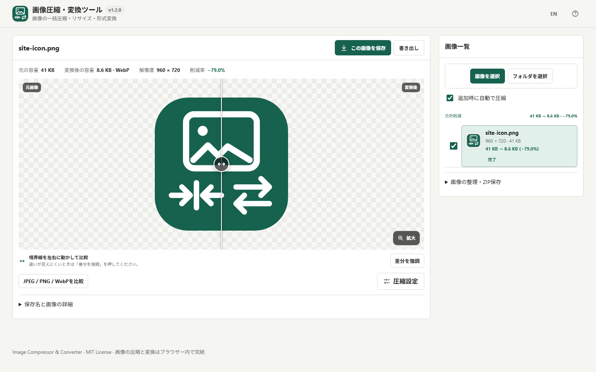
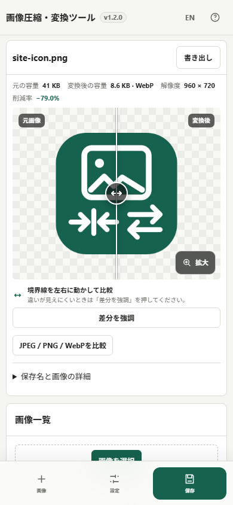

# 画像圧縮・変換ツール / Image Compressor & Converter

[](https://github.com/ttomohisa/htmlapps-image-compressor-converter/actions/workflows/deploy-pages.yml)
[](LICENSE)
[](https://ttomohisa.github.io/htmlapps-image-compressor-converter/)

[English README](README.md)

PNG・JPEG・WebP画像を端末内で圧縮する単体HTMLアプリです。画像を追加すると圧縮が始まり、元画像と見比べてから保存できます。

[最新リリースから単体HTMLをダウンロード](https://github.com/ttomohisa/htmlapps-image-compressor-converter/releases/latest) · [過去のリリース](https://github.com/ttomohisa/htmlapps-image-compressor-converter/releases)

## 使い方

[GitHub Pagesで公開中のアプリを開く](https://ttomohisa.github.io/htmlapps-image-compressor-converter/)。以下はバージョン1.2.0の操作手順です。

1. **画像を追加する。** 画像は複数選択できます。PCではドロップや **Ctrl+V** での貼り付けにも対応しています。追加すると自動で圧縮が始まります。
2. **結果を見比べる。** プレビューの境界線を動かすと、左に元画像、右に圧縮後の画像が表示されます。出力容量と削減率も確認できます。別の画像は一覧から選びます。
3. **保存する。** プレビューで開いている結果は **この画像を保存** で保存します。複数枚をまとめて保存するには画像一覧の保存操作を使います。画像を追加しても以前の結果は一覧に残り、追加分だけが圧縮されます。

圧縮する前に設定したいときは **追加時に自動で圧縮** のチェックを外します。**圧縮設定**（画像追加後のスマホでは画面下の **設定**）で用途や目標容量を選び、**自動圧縮** を押してください。

### 画像の追加

[](https://ttomohisa.github.io/htmlapps-image-compressor-converter/)

### プレビューと画像一覧

[](https://ttomohisa.github.io/htmlapps-image-compressor-converter/)

スマホではプレビューの下に画像一覧があります。画面下の **結果を見る** を押すと、圧縮済みの画像に移動できます。



## 圧縮設定

- 容量に上限があるときは **目標容量** をオンにしてKB数を入力します。**見た目優先 / サイズ優先** を選び、変換後の容量を確認してください。
- 寸法や出力形式を指定するには **詳細設定** で値を選び、**設定どおり変換** を押します。常に指定形式で保存するには **元より大きければ元画像を維持** をオフにします。

自動圧縮では、透過を保ち、指定した品質の上限内で形式と品質を比較します。WebPを出力できないブラウザーでは、透明な画像はPNG、それ以外はJPEGを使います。

## 複数の画像を保存する

圧縮済みの画像をすべてまとめて保存できます。一部だけを保存するには、対象の画像にチェックを付けて **チェック済みをZIP保存** を押します。チェックは、プレビューで開く画像とは別に選べます。**すべて / 解除** で圧縮済みの画像のチェックを一括で変更できます。

全件を保存すると、結果が1枚なら画像ファイル、複数枚ならZIPになります。**チェック済みをZIP保存** は1枚でもZIPになります。保存名は変更できます。フォルダから追加した画像のフォルダ構成はZIPにも引き継がれ、同じフォルダの同名ファイルには連番が付きます。

## 画質を詳しく見比べる

細かい違いは **差分を強調** や拡大表示で確認できます。**JPEG / PNG / WebPを比較** では、今の設定で形式ごとの容量と画像サイズを比べて、保存する候補を選べます。

## Web制作向け出力

圧縮済みの画像で **書き出し** を開くと、次の形式を生成できます。

- Base64 Data URI
- `` 用HTML
- CSS `background-image`
- Markdown画像記法
- フォールバック付き `<picture>`
- Web素材ZIP。編集した保存名と出力寸法に合わせた画像と `snippet.html` をまとめます。透過画像にはPNG、不透明画像にはJPEGを用意し、ブラウザーが対応していればWebPも含めます。

## オフラインで使う

使いたいリリースから単体HTMLをダウンロードし、ブラウザーで直接開きます。容量の小さい自己展開版HTMLは、gzipの `DecompressionStream` に対応したブラウザーで開けます。どちらもオフラインで画像の比較や書き出しまで利用できます。[最新リリースの配布ファイル](https://github.com/ttomohisa/htmlapps-image-compressor-converter/releases/latest) · [オフライン検証](VERIFY_OFFLINE.md)

## GitHub Pagesで公開する

このリポジトリには、単体HTMLをビルド・検証して `dist/` をGitHub Pagesへ自動公開するワークフローが含まれています。

1. リポジトリ名を `htmlapps-image-compressor-converter` としてGitHubへプッシュします。
2. **Settings → Pages → Build and deployment → Source** で **GitHub Actions** を選択します。
3. `main` ブランチへプッシュするか、Actions画面からPages公開ワークフローを手動実行します。
4. ビルド成功後、`https://ttomohisa.github.io/htmlapps-image-compressor-converter/` で公開されます。

GitHub Pagesがまだ有効化されていない場合は、ビルド自体を成功させたままデプロイだけをスキップし、ActionsのSummaryに設定方法を表示する構成です。

## GitHub Releasesで配布する

`main` へのプッシュで `app.config.json` の `version` がプッシュ前より上がると、リリース用ワークフローが起動します。リポジトリ検証の成功後、プッシュされたコミットに `vX.Y.Z` のタグを付けます。1.2.0の公開以降は、次の固定名で最新版をダウンロードできます。[index.html](https://github.com/ttomohisa/htmlapps-image-compressor-converter/releases/latest/download/index.html) · [index.self-extract.html](https://github.com/ttomohisa/htmlapps-image-compressor-converter/releases/latest/download/index.self-extract.html) · [メンテナー向け手順](CONTRIBUTING.md)

## 開発とビルド

```text
.
├─ src/index.template.html       # アプリ本体のソーステンプレート
├─ app.config.json               # アプリ名・バージョン・ビルド設定
├─ dependencies.json             # 内包依存の定義
├─ build-standalone.bat          # Windows用ビルド入口
├─ build-standalone.ps1          # 単体HTML生成処理
├─ scripts/
│  ├─ check-repository.ps1       # リポジトリ・ビルド検証
│  ├─ verify-standalone.ps1      # 単体HTML・通信制約の検証
│  └─ build-self-extract.ps1     # 自己展開版HTML生成
├─ dist/
│  ├─ index.html                 # メインの配布物
│  └─ index.self-extract.html    # 自己展開版
└─ .github/workflows/
   ├─ build-standalone.yml        # ビルド検証
   ├─ deploy-pages.yml            # GitHub Pages公開
   └─ release.yml                 # バージョン付きリリースの公開
```

Windowsでリポジトリを取得し、次のコマンドでビルドします。PowerShellと.NET標準のgzip圧縮を使用します。

```bat
build-standalone.bat
```

ビルドは `dist/` に2種類のHTMLを生成し、通常版HTMLの未置換プレースホルダー、CSP、外部アセット参照を検査します。Node.js 20以降が使える環境では、PowerShellから `.\scripts\check-repository.ps1` を実行すると、回帰テスト、生成物の一致検査、リリース公開のローカル検証も行えます。

## プライバシーと通信防止

このアプリはローカル処理を前提にしています。

- 選択した画像は作業中のブラウザーメモリ内で処理されます。
- 選択した画像をアプリから外部サーバーへアップロードしません。
- Content Security Policyで `connect-src 'none'` を指定しています。
- アナリティクス、テレメトリ、ログイン、クラウド保存はありません。
- 画像データ自体はLocalStorageへ保存せず、言語と変換設定だけを保持します。
- ファイル保存はユーザー操作後にのみ実行します。

GitHub Pages版では最初のHTMLを取得する通信だけ発生します。ページ読み込み後の画像処理は端末内で行われます。完全にネットワークを切って使用する場合は、生成済みの `dist/index.html` を直接開いてください。

## 制限事項

- PNG出力はロスレスです。目標容量モードではPNGは解像度を下げて容量を調整し、JPEG / WebPは品質と解像度の両方を探索します。
- WebPのエンコード可否や結果はブラウザーのCanvas実装に依存します。
- ブラウザーごとに画像エンコーダーが異なるため、同じ設定でも最終ファイルサイズが多少変わる場合があります。
- 非常に大きい画像や大量の一括処理では、端末メモリを多く使用します。
- 再エンコードすると通常はEXIFなどの撮影情報が除去されます。容量を抑えるために元画像をそのまま保存した場合は、元画像に含まれる撮影情報や位置情報も保持されます。
- 再エンコードした画像は静止画になります。元画像をそのまま保存した場合はアニメーションも維持されます。

## 使用ライブラリ

画像処理の実行時にはCanvas、Blob、FileReaderなどのブラウザー標準APIを利用しており、現時点では画像処理用のサードパーティライブラリを必要としません。

依存関係やライセンスについては [THIRD_PARTY_NOTICES.md](THIRD_PARTY_NOTICES.md) を確認してください。

## コントリビューション

バグ報告や機能提案はGitHub Issuesからお願いします。開発への参加方法は [CONTRIBUTING.md](CONTRIBUTING.md) を確認してください。

## ライセンス

Copyright © 2026 ttomohisa

このプロジェクトは [MIT License](LICENSE) で公開されています。
