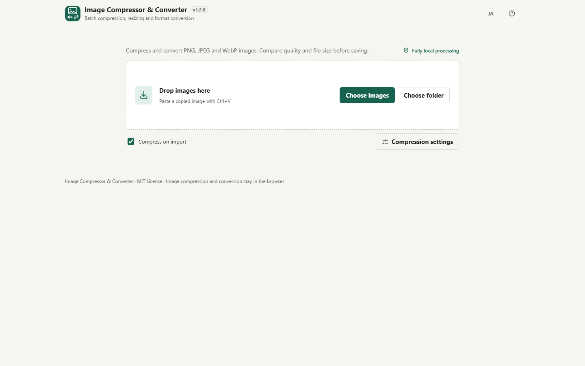

# Image Compressor & Converter

[](https://github.com/ttomohisa/htmlapps-image-compressor-converter/actions/workflows/deploy-pages.yml)
[](LICENSE)
[](https://ttomohisa.github.io/htmlapps-image-compressor-converter/)

[日本語版 README](README.ja.md)

A single-file image compressor for PNG, JPEG and WebP. Smart Optimize compares formats and quality on your device. For an upload limit, set a target size and the app can also reduce the dimensions.

[Download the latest standalone HTML](https://github.com/ttomohisa/htmlapps-image-compressor-converter/releases/latest/download/index.html) · [Release notes and other downloads](https://github.com/ttomohisa/htmlapps-image-compressor-converter/releases)

## 🚀 Live demo

### [Open Image Compressor & Converter on GitHub Pages](https://ttomohisa.github.io/htmlapps-image-compressor-converter/)

GitHub Pages delivers the initial HTML. After it loads, image decoding, resizing, compression, format conversion, comparison, Base64 generation and export are processed locally on your device. Images you select are not uploaded by the app.

### Start screen

[](https://ttomohisa.github.io/htmlapps-image-compressor-converter/)

### Workbench

[](https://ttomohisa.github.io/htmlapps-image-compressor-converter/)

On a phone, use the bottom bar to open settings, start conversion or jump to a finished image with **View results**. Build information is at the end of Help.


## Features

- Add files or a folder and review images, previews and settings side by side on desktop
- **Smart Optimize** compares compression candidates locally. Automatic format selection preserves transparency, even when only one pixel is translucent
- **Target size** searches quality first and progressively reduces dimensions when needed to approach the requested KB limit
- Purpose presets for websites, photos, screenshots, upload limits, README assets, transparent images and format-only conversion
- Automatically keeps the source file when conversion would make it larger (can be disabled for intentional format conversion)
- On desktop, paste screenshots and copied images directly with **Ctrl+V**; file picking supports multiple images on desktop and mobile
- Batch progress and success/failure counts, with source size, output size and savings for available results
- Before / After slider, amplified difference view and 100–400% large preview
- Editable filenames, folder-aware ZIP export and a separate **Save checked ZIP** action with a live count. Name collisions receive numbered suffixes
- Remove one selected image after confirmation and keep the rest of the batch
- Dedicated **Export** dialog for Base64, HTML, CSS, Markdown, `<picture>` and Web-assets ZIP
- Japanese / English UI in the same standalone HTML
- **Fully local processing** after the HTML loads, with runtime network requests blocked by `connect-src 'none'`

## Quick start

### Use the web demo

Just [open the demo](https://ttomohisa.github.io/htmlapps-image-compressor-converter/). No installation or account is required.

### Use it offline

1. Save [index.html](https://github.com/ttomohisa/htmlapps-image-compressor-converter/releases/latest/download/index.html) from the latest release.
2. Open the saved file directly in a current browser. You can disconnect before opening it.
3. Add images and save the results. All processing happens on your device.

For a smaller download, choose the [self-extracting HTML](https://github.com/ttomohisa/htmlapps-image-compressor-converter/releases/latest/download/index.self-extract.html). It opens the same app in browsers with gzip `DecompressionStream` support. For instructions to test both files, see [Offline verification](VERIFY_OFFLINE.md).

## Usage

1. Add one or more PNG, JPEG or WebP images. On desktop, you can also paste screenshots or copied images with **Ctrl+V**. The file picker supports multiple selection on desktop and mobile.
2. Choose a purpose such as **Website**, **Photo**, **Screenshot** or **Size limit**.
3. For upload limits, enable **Target size**, enter the maximum KB and choose **Appearance first** or **Size first**.
4. Run **Smart Optimize**. For a specific format, resize rule or quality ceiling, use **Advanced settings** and **Convert with settings**. Turn off **Keep source if output is larger** when the output format must change.
5. Review Before / After and the batch summary. Check the output size before uploading. Some limits cannot be reached.
6. Save the current image, save the batch as a ZIP, or open **Export** for code and web assets.

### Save checked outputs

Use the checkbox beside each image to include its available output, then choose **Save checked ZIP**. **All / None** changes only available outputs. New images start checked, and their checks become eligible after conversion. Checks stay separate from the preview and **Remove selected**, survive reprocessing, and are kept only for this session. The dedicated action always creates a ZIP, even for one image; the existing current-image and all-output actions keep their behavior.

The archive keeps image order and relative folders. Exact duplicate paths receive numbered suffixes such as `photo (3).webp`; existing names such as `photo (2).webp` are reserved. Edited output names remain unchanged. ZIP paths are case-sensitive.

### Before / After comparison

The draggable divider shows the original on the left and the output on the right in both the workbench and the large preview. With high-quality compression, visible differences can be extremely small even when the file-size reduction is substantial.

Use **Highlight differences** to generate an amplified pixel-difference view when you want to verify where the converted image differs from the source.

### Developer exports

Open **Export** for any converted image to generate any of the following.

- Base64 data URI
- `` HTML
- CSS `background-image`
- Markdown image syntax
- `<picture>` markup with a fallback image
- A web-assets ZIP with `snippet.html`, a PNG fallback for transparent images or a JPEG fallback for opaque images, and a WebP when the browser supports encoding it. The image files use the edited output name. The markup references those files and includes their dimensions.

## Publish with GitHub Pages

The repository includes a workflow that builds the standalone HTML, verifies its offline/runtime-network constraints and deploys `dist/` to GitHub Pages.

1. Push the repository to GitHub as `htmlapps-image-compressor-converter`.
2. Open **Settings → Pages → Build and deployment → Source** and select **GitHub Actions**.
3. Push to `main`, or manually run the Pages deployment workflow from the Actions tab.
4. After a successful deployment, the demo is available at `https://ttomohisa.github.io/htmlapps-image-compressor-converter/`.

If GitHub Pages has not been enabled yet, the workflow keeps the successful build result and skips deployment with setup guidance instead of failing at `configure-pages`.

## GitHub Releases

A push to `main` that increases `version` in `app.config.json` over the previous tip triggers a release. After the repository checks pass, the release workflow publishes tag `vX.Y.Z` at the pushed commit with two downloads, `index.html` and `index.self-extract.html`. The download links above follow the latest published release. [Maintainer instructions](CONTRIBUTING.md)

## Development and build layout

```text
.
├─ src/index.template.html       # Application source template
├─ app.config.json               # App name, version and build settings
├─ dependencies.json             # Embedded dependency definition
├─ build-standalone.bat          # Windows build entry point
├─ build-standalone.ps1          # Standalone HTML builder
├─ scripts/
│  ├─ check-repository.ps1       # Repository/build verification
│  ├─ verify-standalone.ps1      # Standalone/runtime-network checks
│  └─ build-self-extract.ps1     # Self-extracting HTML builder
├─ dist/
│  ├─ index.html                 # Main release artifact
│  └─ index.self-extract.html    # Self-extracting variant
└─ .github/workflows/
   ├─ build-standalone.yml        # Build validation
   ├─ deploy-pages.yml            # GitHub Pages deployment
   └─ release.yml                 # Versioned GitHub Releases
```

Build from a Windows checkout with PowerShell and the built-in .NET gzip support.

```bat
build-standalone.bat
```

This creates both HTML files in `dist/` and checks the readable HTML for placeholders, CSP and external asset references. With Node.js 20+ available, run `.\scripts\check-repository.ps1` from PowerShell for the regression tests, artifact parity checks and a local simulation of release publishing.

## Privacy and runtime network protection

The generated HTML is designed for local-first processing:

- Image bytes remain in browser memory while you work.
- Selected images are not uploaded by the app.
- The runtime Content Security Policy includes `connect-src 'none'`.
- The app has no analytics, telemetry, login or cloud storage.
- Image data is not written to LocalStorage; only language and conversion settings are persisted.
- Downloads occur only after a user action.

The GitHub Pages version requires the initial HTML request. After loading, image processing runs locally. To use the app with the network completely disconnected, open the generated `dist/index.html` directly.

## Limitations

- PNG output is lossless. In target-size mode, PNG can only become smaller by reducing dimensions; JPEG / WebP can adjust both quality and dimensions.
- WebP encoding support depends on the browser's Canvas implementation.
- Exact compressed size can differ between browsers because encoding is browser-provided.
- Very large images or large batches can consume substantial device memory.
- Canvas re-encoding normally removes EXIF metadata. If the app keeps the original file to save space, the saved copy retains its metadata, including any location information.
- Canvas re-encoding produces a still image. A retained original keeps its animation.

## Dependencies

The current image-processing runtime uses browser APIs such as Canvas, Blob and FileReader and does not require a third-party image-processing library at runtime.

See [THIRD_PARTY_NOTICES.md](THIRD_PARTY_NOTICES.md) for dependency and licensing notes.

## Contributing

Bug reports and feature proposals are welcome through GitHub Issues. See [CONTRIBUTING.md](CONTRIBUTING.md) for development guidance.

## License

Copyright © 2026 ttomohisa

Licensed under the [MIT License](LICENSE).
