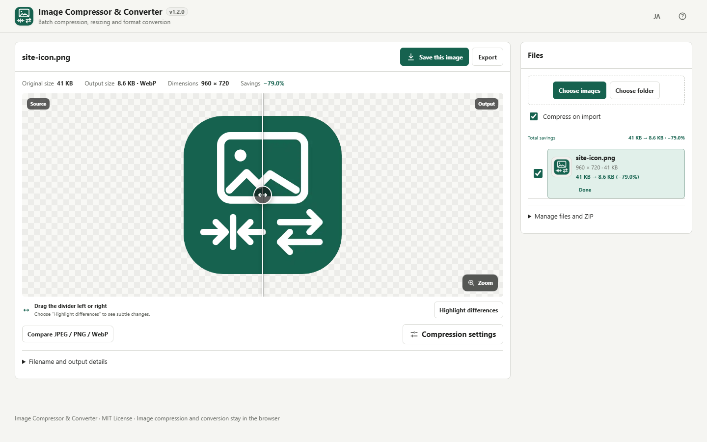
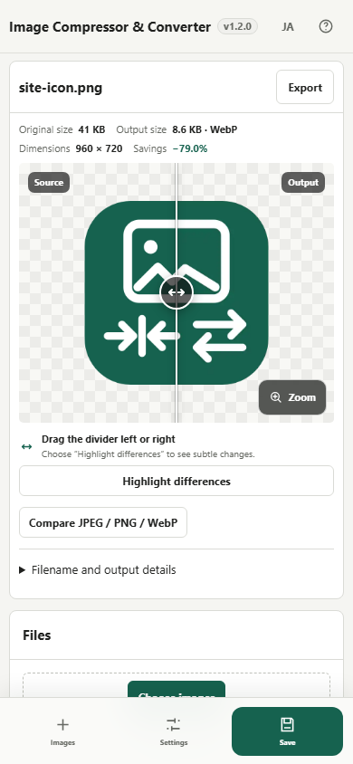

# Image Compressor & Converter

[](https://github.com/ttomohisa/htmlapps-image-compressor-converter/actions/workflows/deploy-pages.yml)
[](LICENSE)
[](https://ttomohisa.github.io/htmlapps-image-compressor-converter/)

[日本語版 README](README.ja.md)

A single-file app for PNG, JPEG and WebP. Add images to compress them on your device, compare the result with the original and save a copy.

[Download a standalone HTML from the latest release](https://github.com/ttomohisa/htmlapps-image-compressor-converter/releases/latest) · [Release history](https://github.com/ttomohisa/htmlapps-image-compressor-converter/releases)

## Quick start

[Open the deployed app on GitHub Pages](https://ttomohisa.github.io/htmlapps-image-compressor-converter/). The following steps describe version 1.2.0.

1. **Add images.** Choose one or more files, drop them onto the desktop picker or paste a copied image with **Ctrl+V** on desktop. Compression starts as soon as you add them.
2. **Compare.** Drag the preview divider to see the original on the left and the result on the right. Check the output size and savings. Choose another file in the list to review it.
3. **Save.** Choose **Save this image** for the previewed result. To save several together, use the batch controls by the file list. Adding more images compresses the new files and keeps earlier results available.

To choose settings before compression, turn off **Compress on import**. Open **Compression settings** (or **Settings** in the phone’s bottom bar after import), choose a purpose or size limit and press **Compress** when ready.

### Start screen

[](https://ttomohisa.github.io/htmlapps-image-compressor-converter/)

### Comparison and file list

[](https://ttomohisa.github.io/htmlapps-image-compressor-converter/)

On a phone, the file list sits below the preview. **View results** in the bottom bar takes you to a finished image.



## Compression settings

- For an upload limit, enable **Target size**, enter the limit in KB and check the file size after conversion. Choose **Appearance first** or **Size first** to set your priority.
- To resize or convert to a specific format, open **Advanced settings**, set the dimensions or format and select **Convert with settings**. Turn off **Keep source if output is larger** to always save in the selected format.

Automatic compression compares formats and quality on your device. It preserves transparency and respects the quality ceiling. If the browser cannot encode WebP, it uses PNG for transparent images or JPEG for opaque ones.

## Save several images

Save all finished images together, or check the ones you want and choose **Save checked ZIP**. Checking an image selects it for the ZIP independently of which preview is open. **All / None** changes the selection for finished images.

Saving all downloads an image directly for one result and a ZIP for several. **Save checked ZIP** always downloads a ZIP, even for one image. You can edit filenames before saving. When you add a folder, its structure is preserved in the ZIP. Matching names in the same folder receive numbered suffixes.

## Compare image quality

Use **Highlight differences** or zoom in to see fine detail. **Compare JPEG / PNG / WebP** shows the size and dimensions for each format under your current settings. Select a result to use it for saving.

## Developer exports

Open **Export** for any converted image to generate any of the following.

- Base64 data URI
- `` HTML
- CSS `background-image`
- Markdown image syntax
- `<picture>` markup with a fallback image
- A web-assets ZIP with `snippet.html`, a PNG fallback for transparent images or a JPEG fallback for opaque images, and a WebP when the browser supports encoding it. The image files use the edited output name. The markup references those files and includes their dimensions.

## Use it offline

Download the standalone HTML asset from the release you want and open it directly in your browser. The smaller self-extracting HTML requires gzip `DecompressionStream` support. Both work offline, including the image comparison and export tools. [Latest release assets](https://github.com/ttomohisa/htmlapps-image-compressor-converter/releases/latest) · [Offline verification](VERIFY_OFFLINE.md)

## Publish with GitHub Pages

The repository includes a workflow that builds the standalone HTML, verifies its offline/runtime-network constraints and deploys `dist/` to GitHub Pages.

1. Push the repository to GitHub as `htmlapps-image-compressor-converter`.
2. Open **Settings → Pages → Build and deployment → Source** and select **GitHub Actions**.
3. Push to `main`, or manually run the Pages deployment workflow from the Actions tab.
4. After a successful deployment, the demo is available at `https://ttomohisa.github.io/htmlapps-image-compressor-converter/`.

If GitHub Pages has not been enabled yet, the workflow keeps the successful build result and skips deployment with setup guidance instead of failing at `configure-pages`.

## GitHub Releases

A push to `main` that increases `version` in `app.config.json` over the previous tip triggers a release. After the repository checks pass, the workflow publishes tag `vX.Y.Z` at the pushed commit. Starting with the 1.2.0 release, the two downloads have stable names. [index.html](https://github.com/ttomohisa/htmlapps-image-compressor-converter/releases/latest/download/index.html) · [index.self-extract.html](https://github.com/ttomohisa/htmlapps-image-compressor-converter/releases/latest/download/index.self-extract.html) · [Maintainer instructions](CONTRIBUTING.md)

## Development and build layout

```text
.
├─ src/index.template.html       # Application source template
├─ app.config.json               # App name, version and build settings
├─ dependencies.json             # Embedded dependency definition
├─ build-standalone.bat          # Windows build entry point
├─ build-standalone.ps1          # Standalone HTML builder
├─ scripts/
│  ├─ check-repository.ps1       # Repository/build verification
│  ├─ verify-standalone.ps1      # Standalone/runtime-network checks
│  └─ build-self-extract.ps1     # Self-extracting HTML builder
├─ dist/
│  ├─ index.html                 # Main release artifact
│  └─ index.self-extract.html    # Self-extracting variant
└─ .github/workflows/
   ├─ build-standalone.yml        # Build validation
   ├─ deploy-pages.yml            # GitHub Pages deployment
   └─ release.yml                 # Versioned GitHub Releases
```

Build from a Windows checkout with PowerShell and the built-in .NET gzip support.

```bat
build-standalone.bat
```

This creates both HTML files in `dist/` and checks the readable HTML for placeholders, CSP and external asset references. With Node.js 20+ available, run `.\scripts\check-repository.ps1` from PowerShell for the regression tests, artifact parity checks and a local simulation of release publishing.

## Privacy and runtime network protection

The generated HTML is designed for local-first processing:

- Image bytes remain in browser memory while you work.
- Selected images are not uploaded by the app.
- The runtime Content Security Policy includes `connect-src 'none'`.
- The app has no analytics, telemetry, login or cloud storage.
- Image data is not written to LocalStorage; only language and conversion settings are persisted.
- Downloads occur only after a user action.

The GitHub Pages version requires the initial HTML request. After loading, image processing runs locally. To use the app with the network completely disconnected, open the generated `dist/index.html` directly.

## Limitations

- PNG output is lossless. In target-size mode, PNG can only become smaller by reducing dimensions; JPEG / WebP can adjust both quality and dimensions.
- WebP encoding support depends on the browser's Canvas implementation.
- Exact compressed size can differ between browsers because encoding is browser-provided.
- Very large images or large batches can consume substantial device memory.
- Canvas re-encoding normally removes EXIF metadata. If the app keeps the original file to save space, the saved copy retains its metadata, including any location information.
- Canvas re-encoding produces a still image. A retained original keeps its animation.

## Dependencies

The current image-processing runtime uses browser APIs such as Canvas, Blob and FileReader and does not require a third-party image-processing library at runtime.

See [THIRD_PARTY_NOTICES.md](THIRD_PARTY_NOTICES.md) for dependency and licensing notes.

## Contributing

Bug reports and feature proposals are welcome through GitHub Issues. See [CONTRIBUTING.md](CONTRIBUTING.md) for development guidance.

## License

Copyright © 2026 ttomohisa

Licensed under the [MIT License](LICENSE).
